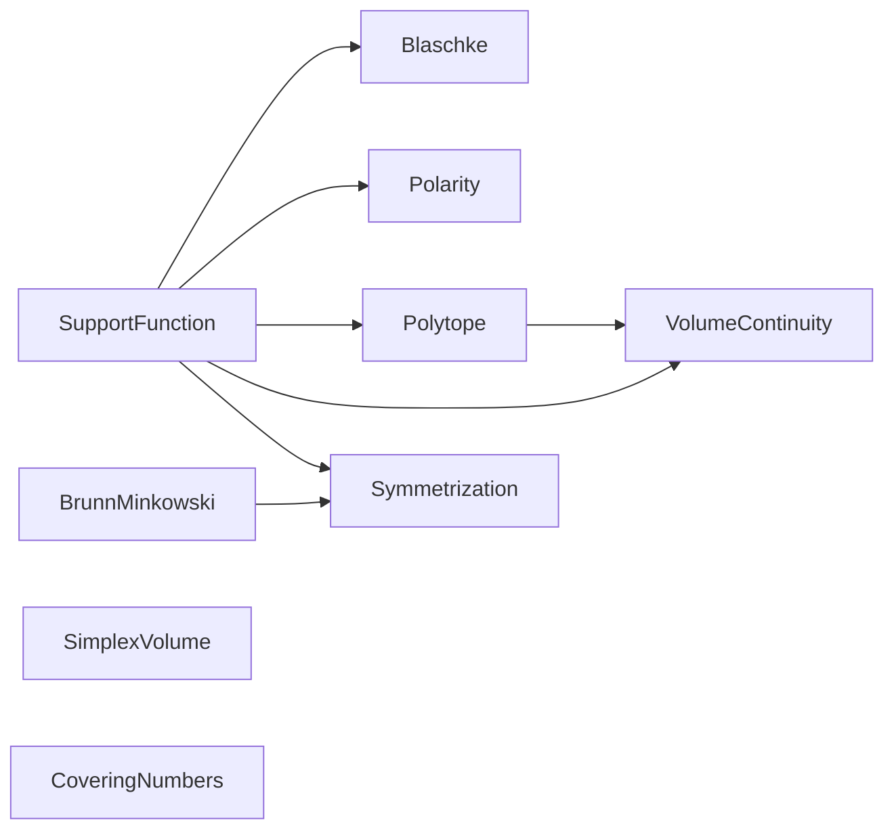

# Repository Map & Module Guide

Overview of the directory layout, internal dependency structure, and main results in `lean-convex-geometry`.

## Repository Layout

```text
.
├── ConvexGeom.lean                         # Root entry point re-exporting all library modules
├── ConvexGeom/
│   ├── SupportFunction.lean                # Support functions, Hörmander isometry, Minkowski representation
│   ├── Blaschke.lean                       # Completeness of ConvexBody and Blaschke Selection Theorem
│   ├── Polarity.lean                       # Polar bodies, Bipolar Theorem, gauge–support duality
│   ├── Polytope.lean                       # Finite convex hulls and inscribed polytope approximation
│   ├── SimplexVolume.lean                  # d-simplex volume |det|/d! via permutation tiling
│   ├── VolumeContinuity.lean               # Half-ball volume and Hausdorff continuity of volume
│   ├── CoveringNumbers.lean                # Volumetric covering and packing bounds for arbitrary norms
│   ├── BrunnMinkowski.lean                 # Prékopa–Leindler, Brunn–Minkowski, isodiametric inequality
│   ├── Symmetrization.lean                 # Minkowski, central, and Steiner symmetrization
│   └── Verification/
│       └── AxiomAudit.lean                 # #print axioms audit across all headline theorems
├── .github/workflows/ci.yml                # Strict CI: lake build --wfail + standard-axiom check
├── README.md                               # Project overview and quick start
├── MODULES.md                              # This repository map
└── ROADMAP.md                              # Planned targets and contribution guide
```

## Module Dependency Graph



All nine library modules are re-exported by [`ConvexGeom.lean`](ConvexGeom.lean) and audited together by [`ConvexGeom/Verification/AxiomAudit.lean`](ConvexGeom/Verification/AxiomAudit.lean).

---

## Metric & Duality Foundations

### [`ConvexGeom/SupportFunction.lean`](ConvexGeom/SupportFunction.lean)
Support function calculus, Hausdorff metric geometry, and Minkowski's representation theorem on real inner product spaces.

- **Constructors & calculus:** `bodySingleton`, `bodyClosedBall`, `supportFn`, `supportFn_minkowski_add`, `supportFn_body_smul`, `supportFn_convexOn`
- **Separation & width:** `supportFn_le_iff_subset`, `supportFn_injective`, `width`, `diam_eq_sSup_width`
- **Hörmander's isometric embedding:** `supportFnOnBall`, `isometry_supportFnOnBall`, `dist_add_right`, `dist_add_le`, `dist_smul`
- **Minkowski's representation:** `exists_convexBody_supportFn_eq`

### [`ConvexGeom/Blaschke.lean`](ConvexGeom/Blaschke.lean)
Completeness and compactness of the Hausdorff space of convex bodies via Hörmander's isometry and Arzelà–Ascoli.

- **Completeness:** `isClosed_range_supportFnOnBall`, `instCompleteSpaceConvexBody`
- **Blaschke Selection Theorem:** `isCompact_subset_closedBall`, `isCompact_subset_of_isCompact`, `blaschke_selection`

### [`ConvexGeom/Polarity.lean`](ConvexGeom/Polarity.lean)
One-sided geometric polarity $S^\circ = \{y \mid \forall x \in S,\; \langle x, y \rangle \le 1\}$, bipolarity, and gauge–support duality.

- **Polar calculus:** `polarBody`, `bodyPolar`, `polarBody_closedBall`, `polarBody_image_continuousLinearMap`
- **Bipolar Theorem:** `polarBody_polarBody`
- **Gauge–support duality:** `gauge_polarBody_eq_supportFn`, `supportFn_bodyPolar_eq_gauge`

### [`ConvexGeom/Polytope.lean`](ConvexGeom/Polytope.lean)
Bridge between finite point sets, convex bodies, and Hausdorff approximation.

- **Polytopes as bodies:** `bodyConvexHull`, `supportFn_bodyConvexHull`
- **Stability & approximation:** `hausdorffDist_convexHull_range_le`, `exists_polytope_dist_lt`

---

## Volume, Stability & Covering

### [`ConvexGeom/SimplexVolume.lean`](ConvexGeom/SimplexVolume.lean)
Lebesgue volume of a $d$-simplex via symmetric-group permutation tiling of $[0, 1]^d$ and a unit-determinant partial-sum shear.

- **Standard simplices:** `volume_orderSimplex`, `volume_solidSimplex`
- **General $d$-simplices:** `volume_convexHull_simplex` (on `Fin d → ℝ`), `volume_convexHull_simplex_euclideanSpace` (on `EuclideanSpace ℝ (Fin d)`)

### [`ConvexGeom/VolumeContinuity.lean`](ConvexGeom/VolumeContinuity.lean)
Half-ball volume identities and continuity of additive Haar measures on `ConvexBody E`.

- **Half-ball bounds:** `addHaar_hyperplane_eq_zero`, `addHaar_halfBall`, `addHaar_le_half_ball`
- **Continuity of volume:** `upperSemicontinuous_addHaar_convexBody`, `lowerSemicontinuous_addHaar_convexBody`, `continuous_addHaar_convexBody`, `continuous_addHaarReal_convexBody`, `continuous_addHaar_convexHull_range`

### [`ConvexGeom/CoveringNumbers.lean`](ConvexGeom/CoveringNumbers.lean)
Volumetric covering and packing bounds for any finite-dimensional real normed space.

- **General add-Haar bounds:** `measure_le_externalCoveringNumber_mul_closedBall`, `packingNumber_mul_ball_le_measure_add_ball`, `coveringNumber_mul_ball_le_measure_add_ball`
- **Unit-ball bounds:** `inv_pow_le_externalCoveringNumber_closedBall` ($(1/\varepsilon)^d$), `packingNumber_closedBall_le` ($(2/\varepsilon + 1)^d$), `coveringNumber_closedBall_le_three_div` ($(3/\varepsilon)^d$)

---

## Inequalities & Symmetrization

### [`ConvexGeom/BrunnMinkowski.lean`](ConvexGeom/BrunnMinkowski.lean)
Prékopa–Leindler in arbitrary dimension (via layer-cake and Tonelli induction) and its geometric corollaries.

- **Prékopa–Leindler:** `brunn_minkowski_one_dim`, `prekopa_leindler_one_dim`, `prekopa_leindler_pi`, `prekopa_leindler`
- **Brunn–Minkowski:** `brunn_minkowski_mul`, `brunn_minkowski_mul_compact`, `brunn_minkowski_compact`, `brunn_minkowski_convexBody`
- **Applications:** `isodiametric_inequality` (Bieberbach), `logConcave_marginal_prod` (Prékopa's marginal theorem)

### [`ConvexGeom/Symmetrization.lean`](ConvexGeom/Symmetrization.lean)
Hyperplane reflection, Minkowski and central symmetrization, and Steiner symmetrization.

- **Reflection & Minkowski symmetrization:** `reflectHyperplane`, `reflectBody`, `minkowskiSymm`, `supportFn_minkowskiSymm`, `reflectBody_minkowskiSymm`, `volume_le_volume_minkowskiSymm`, `diam_minkowskiSymm_le`
- **Central symmetrization:** `centralSymm`, `supportFn_centralSymm`, `volume_le_volume_centralSymm`
- **Steiner symmetrization (on `ℝ × E`):** `steinerSymm`, `convex_steinerSymm`, `isCompact_steinerSymm`, `volume_steinerSymm`, `steinerSymm_dist_le_diam`

---

## Verification

- [`ConvexGeom/Verification/AxiomAudit.lean`](ConvexGeom/Verification/AxiomAudit.lean) prints axioms for all headline theorems across every module.
- [`.github/workflows/ci.yml`](.github/workflows/ci.yml) builds `ConvexGeom` with `--wfail` and rejects any theorem depending on anything outside `[propext, Classical.choice, Quot.sound]`.
