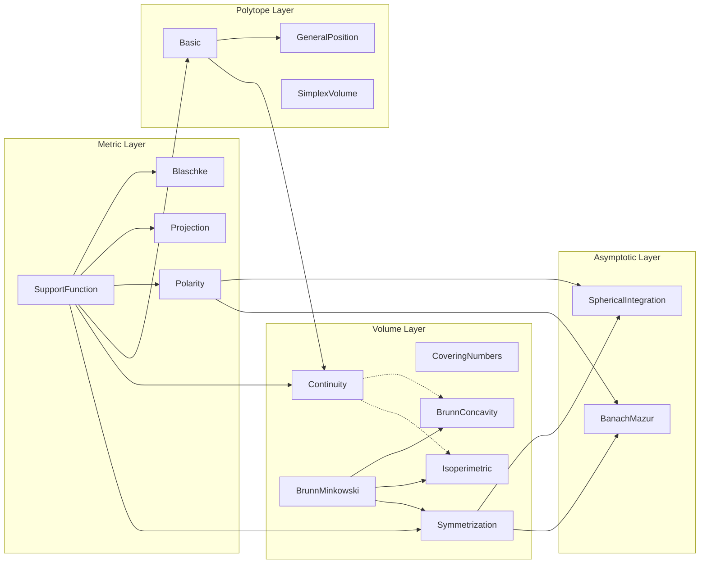

# Repository Map & Module Guide

Overview of the layered directory layout, internal dependency structure, main results, and verification infrastructure in `lean-convex-geometry`.

## Repository Layout

```text
.
├── ConvexGeom.lean                         # Root entry point re-exporting all 4 library layers
├── ConvexGeom/
│   ├── Metric.lean                         # Layer barrel re-exporting ConvexGeom.Metric.*
│   ├── Metric/
│   │   ├── SupportFunction.lean            # Support calculus, mapLinear, Hörmander isometry, bodyOfSupportFn
│   │   ├── Blaschke.lean                   # Completeness of ConvexBody and Blaschke Selection Theorem
│   │   ├── Projection.lean                 # Metric projection, normalCone / strictNormalCone, supporting hyperplanes
│   │   └── Polarity.lean                   # Polar bodies, Bipolar Theorem, gauge–support duality
│   ├── Polytope.lean                       # Layer barrel re-exporting ConvexGeom.Polytope.*
│   ├── Polytope/
│   │   ├── Basic.lean                      # Finite convex hulls and inscribed polytope approximation
│   │   ├── SimplexVolume.lean              # d-simplex volume |det|/d! (linear map & matrix det interfaces)
│   │   └── GeneralPosition.lean            # Affine general position density & full-dim inscribed approximation
│   ├── Volume.lean                         # Layer barrel re-exporting ConvexGeom.Volume.*
│   ├── Volume/
│   │   ├── Continuity.lean                 # Volume-root scaling, half-ball bounds, Hausdorff continuity & maximizers
│   │   ├── CoveringNumbers.lean            # Volumetric covering and packing bounds for arbitrary norms
│   │   ├── BrunnMinkowski.lean             # Prékopa–Leindler, Brunn–Minkowski, isodiametric inequality
│   │   ├── BrunnConcavity.lean             # Brunn concavity, log-concave convolutions, covariogram, Rogers–Shephard
│   │   ├── Isoperimetric.lean              # Minkowski's first inequality and Euclidean isoperimetry (outer content)
│   │   └── Symmetrization.lean             # Reflection, Minkowski, central, and Steiner symmetrization
│   ├── Asymptotic.lean                     # Layer barrel re-exporting ConvexGeom.Asymptotic.*
│   ├── Asymptotic/
│   │   ├── SphericalIntegration.lean       # Haar-invariant sphereProb, polar volume, mean width, Dual Urysohn
│   │   └── BanachMazur.lean                # Symmetric bodies, ellipsoids, Mahler/Santaló volume, linear/affine BM
│   └── Verification/
│       ├── AuditTool.lean                  # Exhaustive environment-wide axiom & module-completeness tool
│       └── AxiomAudit.lean                 # Human-readable #print axioms snapshot for headline theorems
├── ConvexGeomTest.lean                     # Root entry point for regression & counterexample test suite
├── ConvexGeomTest/
│   ├── SmokeImports.lean                   # Standalone public-API smoke check (imports only ConvexGeom)
│   ├── Metric.lean                         # Support, mapLinear, bodyOfSupportFn, normalCone, polarity tests
│   ├── Polytope.lean                       # Simplex matrix/coord volume & dim 0/1/2 general position tests
│   ├── Volume.lean                         # Covering, BM, covariogram, Steiner disconnected-fiber & norm tests
│   └── Asymptotic.lean                     # 1D interval counterexamples (BM/Mahler), sphereProb Haar invariance
├── scripts/
│   ├── verify.sh                           # Unified local & CI verification pipeline
│   └── test_audit.sh                       # Negative & positive control suite for convexgeom-audit
├── .github/workflows/ci.yml                # Hardened CI running scripts/verify.sh + JSON report artifact
├── LICENSE                                 # Apache License 2.0
├── CITATION.cff                            # Citation metadata
├── README.md                               # Project overview, conventions, and quick start
├── MODULES.md                              # This repository map
└── ROADMAP.md                              # Planned targets and contribution guide
```

## Module Dependency Graph

The library is organized into four acyclic layers (`Metric → Polytope → Volume → Asymptotic`). Solid arrows denote `public import` dependencies; dashed arrows denote private proof-only `import` dependencies.



All four layer barrels (`ConvexGeom.Metric`, `ConvexGeom.Polytope`, `ConvexGeom.Volume`, `ConvexGeom.Asymptotic`) and their fifteen leaf modules are re-exported by [`ConvexGeom.lean`](ConvexGeom.lean) and audited exhaustively by `convexgeom-audit`.

---

## Metric Layer (`ConvexGeom.Metric`)

### [`ConvexGeom/Metric/SupportFunction.lean`](ConvexGeom/Metric/SupportFunction.lean)
Support function calculus, continuous-linear transport, Hausdorff metric geometry, and constructive Minkowski representation on real inner product spaces.

- **Constructors & linear transport:** `bodySingleton`, `bodyClosedBall`, `mapLinear`, `dist_mapLinear_le`, `supportFn`, `supportFn_minkowski_add`, `supportFn_body_smul`, `supportFn_mapLinearIsometry`, `supportFn_convexOn`
- **Separation, halfspace characterization & width:** `supportFn_le_iff_subset`, `supportFn_injective`, `mem_iff_forall_inner_le_supportFn`, `width`, `diam_eq_sSup_width`, `diam_eq_sSup_width_sphere`
- **Hörmander's isometric embedding:** `supportFnOnBall`, `dist_le_iff_supportFn_sub_le`, `dist_le_iff_supportFn_sub_le_sphere`, `isometry_supportFnOnBall`, `dist_add_right`, `dist_add_le`, `dist_smul`
- **Constructive Minkowski representation:** `bodyOfSupportFn`, `supportFn_bodyOfSupportFn`, `exists_convexBody_supportFn_eq`

### [`ConvexGeom/Metric/Blaschke.lean`](ConvexGeom/Metric/Blaschke.lean)
Completeness and compactness of the Hausdorff space of convex bodies via Hörmander's isometry and Arzelà–Ascoli.

- **Completeness:** `isClosed_range_supportFnOnBall`, `instCompleteSpaceConvexBody`
- **Blaschke Selection Theorem:** `isCompact_subset_closedBall`, `isCompact_subset_of_isCompact`, `blaschke_selection`

### [`ConvexGeom/Metric/Projection.lean`](ConvexGeom/Metric/Projection.lean)
Nearest-point metric projection onto convex bodies, outer normal cones, and the Supporting Hyperplane Theorem.

- **Metric projection:** `metricProj`, `metricProj_eq_iff` (variational characterization), `sq_norm_metricProj_sub_le` (firm non-expansiveness), `lipschitzWith_metricProj` (1-Lipschitz contraction), `metricProj_mem_frontier_of_not_mem`
- **Normal cones & supporting hyperplanes:** `normalCone`, `strictNormalCone`, `mem_normalCone_iff_supportFn`, `exists_supporting_normal_of_mem_frontier`, `exists_unit_supportFn_eq_of_mem_frontier`

### [`ConvexGeom/Metric/Polarity.lean`](ConvexGeom/Metric/Polarity.lean)
One-sided geometric polarity $S^\circ = \{y \mid \forall x \in S,\; \langle x, y \rangle \le 1\}$, bipolarity, and gauge–support duality.

- **Polar calculus:** `polarBody`, `bodyPolar`, `polarBody_closedBall`, `polarBody_image_continuousLinearMap`
- **Bipolar Theorem:** `polarBody_polarBody`
- **Gauge–support duality:** `gauge_polarBody_eq_supportFn`, `supportFn_bodyPolar_eq_gauge`

---

## Polytope Layer (`ConvexGeom.Polytope`)

### [`ConvexGeom/Polytope/Basic.lean`](ConvexGeom/Polytope/Basic.lean)
Bridge between finite point sets, convex bodies, and Hausdorff approximation.

- **Polytopes as bodies:** `bodyConvexHull`, `supportFn_bodyConvexHull`
- **Stability & approximation:** `hausdorffDist_convexHull_range_le`, `exists_polytope_dist_lt`

### [`ConvexGeom/Polytope/SimplexVolume.lean`](ConvexGeom/Polytope/SimplexVolume.lean)
Lebesgue volume of a $d$-simplex via symmetric-group permutation tiling of $[0, 1]^d$ and a unit-determinant partial-sum shear.

- **Standard simplices:** `volume_orderSimplex`, `volume_solidSimplex`
- **Edge map & matrix interfaces:** `simplexEdgeMap`, `simplexEdgeMatrix`, `det_simplexEdgeMap_eq_det_matrix`
- **General $d$-simplices:** `volume_convexHull_simplex`, `volume_convexHull_simplex_matrix` (on `Fin d → ℝ`); `volume_convexHull_simplex_euclideanSpace`, `volume_convexHull_simplex_euclideanSpace_matrix` (on `EuclideanSpace ℝ (Fin d)`)

### [`ConvexGeom/Polytope/GeneralPosition.lean`](ConvexGeom/Polytope/GeneralPosition.lean)
Affine general position in finite-dimensional real normed spaces and general-position polytope approximation.

- **General position & invariance:** `InGeneralPosition` (requiring `[FiniteDimensional ℝ E]`), `InGeneralPosition.injective`, `InGeneralPosition.comp_injective`, `InGeneralPosition.affineEquiv`
- **Measure-zero spans & density:** `addHaar_affineSpan_image_eq_zero`, `addHaar_affineSpan_finset_eq_zero`, `exists_generalPosition_snoc`, `exists_generalPosition_dist_lt`, `exists_generalPosition_dist_lt_of_fintype`
- **Polytope approximation:** `nonempty_interior_convexHull_of_inGeneralPosition`, `exists_generalPosition_polytope_dist_lt` (ambient), `exists_inscribed_generalPosition_polytope_dist_lt` (inscribed full-dimensional for bodies with nonempty interior)

---

## Volume Layer (`ConvexGeom.Volume`)

### [`ConvexGeom/Volume/Continuity.lean`](ConvexGeom/Volume/Continuity.lean)
Volume-root scaling, half-ball volume bounds, Hausdorff continuity of additive Haar measures, and existence of inscribed polytope volume maximizers.

- **Volume-root scaling:** `addHaar_smul_rpow_inv_finrank`, `addHaar_real_smul_rpow_inv_finrank`
- **Half-ball bounds:** `addHaar_hyperplane_eq_zero`, `addHaar_halfBall`, `addHaar_le_half_ball`, `addHaar_le_half_closedBall_of_zero_not_mem_interior`
- **Continuity & maximizers:** `upperSemicontinuous_addHaar_convexBody`, `lowerSemicontinuous_addHaar_convexBody`, `continuous_addHaar_convexBody`, `continuous_addHaarReal_convexBody`, `continuous_addHaar_convexHull_range`, `continuous_addHaarReal_convexHull_range`, `exists_max_addHaar_convexHull_of_isCompact`, `exists_max_addHaar_convexHull_sphere`, `exists_max_addHaar_convexHull_closedBall`

### [`ConvexGeom/Volume/CoveringNumbers.lean`](ConvexGeom/Volume/CoveringNumbers.lean)
Volumetric covering and packing bounds for any finite-dimensional real normed space.

- **General add-Haar bounds:** `measure_le_externalCoveringNumber_mul_closedBall`, `packingNumber_mul_ball_le_measure_add_ball`, `coveringNumber_mul_ball_le_measure_add_ball`
- **Unit-ball bounds:** `inv_pow_le_externalCoveringNumber_closedBall` ($(1/\varepsilon)^d$), `packingNumber_closedBall_le` ($(2/\varepsilon + 1)^d$), `coveringNumber_closedBall_le_three_div` ($(3/\varepsilon)^d$)

### [`ConvexGeom/Volume/BrunnMinkowski.lean`](ConvexGeom/Volume/BrunnMinkowski.lean)
Prékopa–Leindler in arbitrary dimension (via layer-cake and Tonelli induction) and its geometric corollaries.

- **Prékopa–Leindler:** `brunn_minkowski_one_dim`, `prekopa_leindler_one_dim`, `prekopa_leindler_pi`, `prekopa_leindler`
- **Brunn–Minkowski:** `brunn_minkowski_mul`, `brunn_minkowski_mul_compact`, `brunn_minkowski_compact`, `brunn_minkowski_convexBody`
- **Applications:** `isodiametric_inequality` (Bieberbach), `logConcave_marginal_prod` (Prékopa's marginal theorem)

### [`ConvexGeom/Volume/BrunnConcavity.lean`](ConvexGeom/Volume/BrunnConcavity.lean)
Parallel hyperplane sections, log-concave convolutions, covariograms, and the Rogers–Shephard inequality.

- **Brunn's Concavity Principle:** `slice`, `logConcave_sections`, `brunn_concavity_sections`, `concaveOn_volume_slice_rpow`
- **Log-concave convolutions:** `logConcave_convolution`
- **Covariogram & Rogers–Shephard:** `covariogram`, `covariogram_lintegral`, `covariogram_rpow_concave`, `two_pow_mul_volume_le_volume_diff`, `rogers_shephard` ($2^d\,\mathrm{vol}(K) \le \mathrm{vol}(K - K) \le \binom{2d}{d}\,\mathrm{vol}(K)$)

### [`ConvexGeom/Volume/Isoperimetric.lean`](ConvexGeom/Volume/Isoperimetric.lean)
First variation of Minkowski volume, Minkowski's first inequality, and Euclidean isoperimetry via lower outer Minkowski content.

- **First variation & Minkowski's First Inequality:** `volume_add_smul_ge`, `minkowski_first_diff_ge`, `minkowskiSurfaceArea`, `minkowski_first_inequality`
- **Euclidean Isoperimetric Inequality:** `minkowskiSurfaceArea_closedBall`, `isoperimetric_inequality`, `isoperimetric_inequality_ball`

### [`ConvexGeom/Volume/Symmetrization.lean`](ConvexGeom/Volume/Symmetrization.lean)
Hyperplane reflection, Minkowski and central symmetrization, and Steiner symmetrization.

- **Reflection & Minkowski symmetrization:** `reflectHyperplane`, `reflectBody`, `minkowskiSymm`, `supportFn_minkowskiSymm`, `reflectBody_minkowskiSymm`, `volume_le_volume_minkowskiSymm`, `diam_minkowskiSymm_le`
- **Central symmetrization:** `centralSymm`, `supportFn_centralSymm`, `volume_le_volume_centralSymm`
- **Steiner symmetrization (on `ℝ × E`):** `steinerSymm`, `convex_steinerSymm`, `isCompact_steinerSymm`, `volume_steinerSymm`, `steinerSymm_dist_le_diam`, `bodySteinerSymm`, `volume_bodySteinerSymm`

---

## Asymptotic Layer (`ConvexGeom.Asymptotic`)

### [`ConvexGeom/Asymptotic/SphericalIntegration.lean`](ConvexGeom/Asymptotic/SphericalIntegration.lean)
Haar-invariant spherical cone probability measure, polar-coordinate volume representation, mean width calculus, and Urysohn bridges.

- **Uniform spherical measure:** `sphereMap`, `sphereProb`, `sphereProb_eq_of_isAddHaarMeasure`, `measurePreserving_sphereMap_sphereProb`, `measurePreserving_sphereNeg_sphereProb`
- **Polar volume formulas:** `addHaar_eq_lintegral_gauge_inv_pow`, `addHaar_real_eq_integral_gauge_inv_pow`, `addHaar_real_polarBody_eq_integral_supportFn_inv_pow`
- **Mean width:** `meanWidth`, `integral_width_eq_two_mul_meanWidth`, `meanWidth_add`, `meanWidth_smul`, `meanWidth_translate`, `meanWidth_bodyClosedBall`, `lipschitzWith_meanWidth`, `meanWidth_linearIsometry`, `meanWidth_mapLinearIsometry`, `meanWidth_minkowskiSymm`, `meanWidth_centralSymm`
- **Urysohn bounds:** `dual_urysohn_inequality`, `urysohn_of_santalo`, `urysohn_of_santalo_at` (conditional Blaschke–Santaló $\Rightarrow$ Urysohn bridge)

### [`ConvexGeom/Asymptotic/BanachMazur.lean`](ConvexGeom/Asymptotic/BanachMazur.lean)
Origin-symmetric convex bodies, centered ellipsoids, origin-centered & Santaló Mahler volume, and linear / affine Banach–Mazur distances.

- **Symmetric bodies & polarity:** `IsOriginSymmetric`, `isOriginSymmetric_convexBody_iff_supportFn`, `gauge_smul_abs_of_isOriginSymmetric`, `mem_polarBody_iff_abs_inner_le_one`, `det_adjoint_eq_det`, `polarBody_linearEquiv_image`
- **Ellipsoids & Mahler volume:** `ellipsoid`, `polarBody_ellipsoid`, `addHaar_ellipsoid`, `mahlerVolume`, `mahlerVolume_linearEquiv`, `mahlerVolume_ellipsoid`, `mahlerVolumeAt`, `mahlerVolumeAt_affineEquiv`, `santaloMahlerVolume`, `santaloMahlerVolume_translate`, `santaloMahlerVolume_affineEquiv`
- **Linear Banach–Mazur distance:** `banachMazurDist`, `banachMazurEDist`, `banachMazurEDist_eq_top_of_empty`, `banachMazurEDist_mul_triangle`, `banachMazurDist_polar`, `mahlerVolume_le_banachMazurDist_pow_mul`
- **Affine Banach–Mazur distance:** `affineBanachMazurSet`, `affineBanachMazurDist`, `affineBanachMazurEDist`, `affineBanachMazurDist_affineEquiv_left`, `affineBanachMazurDist_affineEquiv_right`, `affineBanachMazurEDist_mul_triangle`

---

## Verification & Regression Tests

- [`ConvexGeom/Verification/AuditTool.lean`](ConvexGeom/Verification/AuditTool.lean) (`lake exe convexgeom-audit`): Initializer-free exhaustive environment-wide audit enumerating every module and declaration (public and private, across all namespaces) in `ConvexGeom`, checking filesystem module completeness, rejecting any project-defined `axiom` or dependency outside `{propext, Classical.choice, Quot.sound}`, and emitting a structured JSON report with toolchain, Git commit, and manifest hash metadata.
- [`scripts/test_audit.sh`](scripts/test_audit.sh): Automated negative- and positive-control test suite verifying that `convexgeom-audit` rejects unused public/private axioms, custom-axiom dependencies, public/private `sorry`, non-project-namespace axioms, and orphan modules while accepting clean fixtures and the production library.
- [`ConvexGeom/Verification/AxiomAudit.lean`](ConvexGeom/Verification/AxiomAudit.lean): Human-readable `#print axioms` snapshot of headline theorems, parsed with exact set-equality and `-DwarningAsError=true`.
- [`ConvexGeomTest/`](ConvexGeomTest/): Separate Lake test library (not re-exported by `ConvexGeom`) checking standalone public imports, boundary conventions, exact simplex & general-position examples, and proven 1D counterexamples documenting the distinction between linear vs affine Banach–Mazur distance, origin-centered vs Santaló Mahler volume, infeasible distortion totalization, disconnected-fiber Steiner symmetrization, and the product max-norm on `ℝ × E`.
- [`scripts/verify.sh`](scripts/verify.sh) & [`.github/workflows/ci.yml`](.github/workflows/ci.yml): Single verification entry point executed both locally and in hardened CI (pinned action SHAs, SHA-256 verified `elan` installation, least-privilege permissions, and JSON audit artifact upload).
