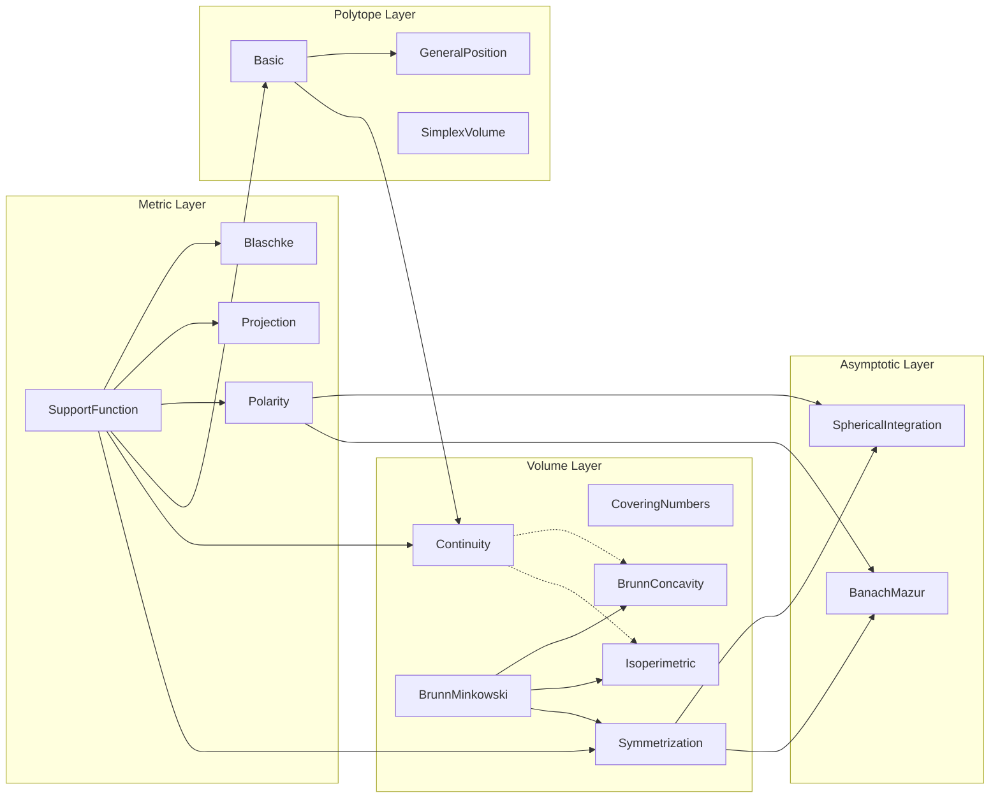

# Module Guide

Directory layout, internal dependencies, and main declarations in `lean-convex-geometry`.

## Repository Layout

```text
.
├── ConvexGeom.lean                         # Root module re-exporting all 4 layers
├── ConvexGeom/
│   ├── Metric.lean                         # Layer barrel for ConvexGeom.Metric.*
│   ├── Metric/
│   │   ├── SupportFunction.lean            # Support calculus, mapLinear, Hörmander isometry, bodyOfSupportFn
│   │   ├── Blaschke.lean                   # Completeness of ConvexBody and Blaschke Selection Theorem
│   │   ├── Projection.lean                 # Metric projection, normal cones, supporting hyperplanes
│   │   └── Polarity.lean                   # Polar bodies, Bipolar Theorem, gauge–support duality
│   ├── Polytope.lean                       # Layer barrel for ConvexGeom.Polytope.*
│   ├── Polytope/
│   │   ├── Basic.lean                      # Finite convex hulls and inscribed polytope approximation
│   │   ├── SimplexVolume.lean              # d-simplex volume |det|/d! (linear map & matrix det)
│   │   └── GeneralPosition.lean            # Affine general position density & inscribed approximation
│   ├── Volume.lean                         # Layer barrel for ConvexGeom.Volume.*
│   ├── Volume/
│   │   ├── Continuity.lean                 # Volume-root scaling, half-ball bounds, volume continuity & maximizers
│   │   ├── CoveringNumbers.lean            # Volumetric covering and packing bounds for arbitrary norms
│   │   ├── BrunnMinkowski.lean             # Prékopa–Leindler, Brunn–Minkowski, isodiametric inequality
│   │   ├── BrunnConcavity.lean             # Brunn concavity, log-concave convolutions, covariogram, Rogers–Shephard
│   │   ├── Isoperimetric.lean              # Minkowski's first inequality and Euclidean isoperimetry
│   │   └── Symmetrization.lean             # Reflection, Minkowski, central, and Steiner symmetrization
│   ├── Asymptotic.lean                     # Layer barrel for ConvexGeom.Asymptotic.*
│   ├── Asymptotic/
│   │   ├── SphericalIntegration.lean       # sphereProb, polar volume, mean width, Dual Urysohn
│   │   └── BanachMazur.lean                # Symmetric bodies, ellipsoids, Mahler/Santaló volume, BM distances
│   └── Verification/                       # Axiom audit tool, headline snapshot, internal checks
├── docs/
│   ├── MODULES.md                          # This file
│   ├── CONVENTIONS.md                      # Conventions and verification scope
│   └── ROADMAP.md                          # Planned targets and contribution guide
├── scripts/                                # Verification and audit-control scripts
├── LICENSE                                 # Apache License 2.0
├── CITATION.cff                            # Citation metadata
└── README.md                               # Project overview
```

## Module Dependency Graph

Solid arrows denote `public import` dependencies; dashed arrows denote private proof-only imports.



All four layer barrels and their leaf modules are re-exported by [`ConvexGeom.lean`](../ConvexGeom.lean).

---

## Metric Layer (`ConvexGeom.Metric`)

### [`ConvexGeom/Metric/SupportFunction.lean`](../ConvexGeom/Metric/SupportFunction.lean)
Support functions, linear transport, Hausdorff metric, and Minkowski's representation theorem.

- **Constructors & transport:** `bodySingleton`, `bodyClosedBall`, `mapLinear`, `dist_mapLinear_le`, `supportFn`, `supportFn_minkowski_add`, `supportFn_body_smul`, `supportFn_mapLinearIsometry`, `supportFn_convexOn`
- **Separation & width:** `supportFn_le_iff_subset`, `supportFn_injective`, `mem_iff_forall_inner_le_supportFn`, `width`, `diam_eq_sSup_width`, `diam_eq_sSup_width_sphere`
- **Hörmander's embedding:** `supportFnOnBall`, `dist_le_iff_supportFn_sub_le`, `dist_le_iff_supportFn_sub_le_sphere`, `isometry_supportFnOnBall`, `dist_add_right`, `dist_add_le`, `dist_smul`
- **Minkowski's representation:** `bodyOfSupportFn`, `supportFn_bodyOfSupportFn`, `exists_convexBody_supportFn_eq`

### [`ConvexGeom/Metric/Blaschke.lean`](../ConvexGeom/Metric/Blaschke.lean)
Completeness and compactness of `ConvexBody E` via Hörmander's isometry and Arzelà–Ascoli.

- **Completeness:** `isClosed_range_supportFnOnBall`, `instCompleteSpaceConvexBody`
- **Blaschke Selection Theorem:** `isCompact_subset_closedBall`, `isCompact_subset_of_isCompact`, `blaschke_selection`

### [`ConvexGeom/Metric/Projection.lean`](../ConvexGeom/Metric/Projection.lean)
Nearest-point metric projection, outer normal cones, and the Supporting Hyperplane Theorem.

- **Metric projection:** `metricProj`, `metricProj_eq_iff`, `sq_norm_metricProj_sub_le`, `lipschitzWith_metricProj`, `metricProj_mem_frontier_of_not_mem`
- **Normal cones & supporting hyperplanes:** `normalCone`, `strictNormalCone`, `mem_normalCone_iff_supportFn`, `exists_supporting_normal_of_mem_frontier`, `exists_unit_supportFn_eq_of_mem_frontier`

### [`ConvexGeom/Metric/Polarity.lean`](../ConvexGeom/Metric/Polarity.lean)
One-sided polarity $S^\circ = \{y \mid \forall x \in S,\; \langle x, y \rangle \le 1\}$, bipolarity, and gauge–support duality.

- **Polar calculus:** `polarBody`, `bodyPolar`, `polarBody_closedBall`, `polarBody_image_continuousLinearMap`
- **Bipolar Theorem:** `polarBody_polarBody`
- **Gauge–support duality:** `gauge_polarBody_eq_supportFn`, `supportFn_bodyPolar_eq_gauge`

---

## Polytope Layer (`ConvexGeom.Polytope`)

### [`ConvexGeom/Polytope/Basic.lean`](../ConvexGeom/Polytope/Basic.lean)
Finite convex hulls as `ConvexBody E` and Hausdorff approximation.

- **Polytopes:** `bodyConvexHull`, `supportFn_bodyConvexHull`
- **Approximation:** `hausdorffDist_convexHull_range_le`, `exists_polytope_dist_lt`

### [`ConvexGeom/Polytope/SimplexVolume.lean`](../ConvexGeom/Polytope/SimplexVolume.lean)
Lebesgue volume of a $d$-simplex via permutation tiling of $[0, 1]^d$ and a unit-determinant shear.

- **Standard simplices:** `volume_orderSimplex`, `volume_solidSimplex`
- **Edge map & matrix:** `simplexEdgeMap`, `simplexEdgeMatrix`, `det_simplexEdgeMap_eq_det_matrix`
- **General $d$-simplices:** `volume_convexHull_simplex`, `volume_convexHull_simplex_matrix`, `volume_convexHull_simplex_euclideanSpace`, `volume_convexHull_simplex_euclideanSpace_matrix`

### [`ConvexGeom/Polytope/GeneralPosition.lean`](../ConvexGeom/Polytope/GeneralPosition.lean)
Affine general position in finite-dimensional normed spaces and general-position polytope approximation.

- **General position:** `InGeneralPosition`, `InGeneralPosition.injective`, `InGeneralPosition.comp_injective`, `InGeneralPosition.affineEquiv`
- **Density:** `addHaar_affineSpan_image_eq_zero`, `addHaar_affineSpan_finset_eq_zero`, `exists_generalPosition_snoc`, `exists_generalPosition_dist_lt`, `exists_generalPosition_dist_lt_of_fintype`
- **Approximation:** `nonempty_interior_convexHull_of_inGeneralPosition`, `exists_generalPosition_polytope_dist_lt`, `exists_inscribed_generalPosition_polytope_dist_lt`

---

## Volume Layer (`ConvexGeom.Volume`)

### [`ConvexGeom/Volume/Continuity.lean`](../ConvexGeom/Volume/Continuity.lean)
Volume-root scaling, half-ball bounds, Hausdorff continuity of additive Haar measures, and inscribed volume maximizers.

- **Scaling & half-balls:** `addHaar_smul_rpow_inv_finrank`, `addHaar_real_smul_rpow_inv_finrank`, `addHaar_hyperplane_eq_zero`, `addHaar_halfBall`, `addHaar_le_half_ball`, `addHaar_le_half_closedBall_of_zero_not_mem_interior`
- **Continuity & maximizers:** `upperSemicontinuous_addHaar_convexBody`, `lowerSemicontinuous_addHaar_convexBody`, `continuous_addHaar_convexBody`, `continuous_addHaarReal_convexBody`, `continuous_addHaar_convexHull_range`, `continuous_addHaarReal_convexHull_range`, `exists_max_addHaar_convexHull_of_isCompact`, `exists_max_addHaar_convexHull_sphere`, `exists_max_addHaar_convexHull_closedBall`

### [`ConvexGeom/Volume/CoveringNumbers.lean`](../ConvexGeom/Volume/CoveringNumbers.lean)
Volumetric covering and packing bounds for arbitrary finite-dimensional norms.

- **General add-Haar bounds:** `measure_le_externalCoveringNumber_mul_closedBall`, `packingNumber_mul_ball_le_measure_add_ball`, `coveringNumber_mul_ball_le_measure_add_ball`
- **Unit-ball bounds:** `inv_pow_le_externalCoveringNumber_closedBall`, `packingNumber_closedBall_le`, `coveringNumber_closedBall_le_three_div`

### [`ConvexGeom/Volume/BrunnMinkowski.lean`](../ConvexGeom/Volume/BrunnMinkowski.lean)
Prékopa–Leindler (layer-cake + Tonelli induction), Brunn–Minkowski, and corollaries.

- **Prékopa–Leindler:** `brunn_minkowski_one_dim`, `prekopa_leindler_one_dim`, `prekopa_leindler_pi`, `prekopa_leindler`
- **Brunn–Minkowski:** `brunn_minkowski_mul`, `brunn_minkowski_mul_compact`, `brunn_minkowski_compact`, `brunn_minkowski_convexBody`
- **Corollaries:** `isodiametric_inequality`, `logConcave_marginal_prod`

### [`ConvexGeom/Volume/BrunnConcavity.lean`](../ConvexGeom/Volume/BrunnConcavity.lean)
Hyperplane sections, log-concave convolutions, covariograms, and Rogers–Shephard.

- **Sections & convolutions:** `slice`, `logConcave_sections`, `brunn_concavity_sections`, `concaveOn_volume_slice_rpow`, `logConcave_convolution`
- **Covariogram & Rogers–Shephard:** `covariogram`, `covariogram_lintegral`, `covariogram_rpow_concave`, `two_pow_mul_volume_le_volume_diff`, `rogers_shephard`

### [`ConvexGeom/Volume/Isoperimetric.lean`](../ConvexGeom/Volume/Isoperimetric.lean)
First variation of volume, Minkowski's first inequality, and Euclidean isoperimetry (lower outer Minkowski content).

- **First inequality:** `volume_add_smul_ge`, `minkowski_first_diff_ge`, `minkowskiSurfaceArea`, `minkowski_first_inequality`
- **Isoperimetry:** `minkowskiSurfaceArea_closedBall`, `isoperimetric_inequality`, `isoperimetric_inequality_ball`

### [`ConvexGeom/Volume/Symmetrization.lean`](../ConvexGeom/Volume/Symmetrization.lean)
Hyperplane reflection, Minkowski and central symmetrization, and Steiner symmetrization on `ℝ × E`.

- **Reflection & Minkowski / central:** `reflectHyperplane`, `reflectBody`, `minkowskiSymm`, `supportFn_minkowskiSymm`, `reflectBody_minkowskiSymm`, `volume_le_volume_minkowskiSymm`, `diam_minkowskiSymm_le`, `centralSymm`, `volume_le_volume_centralSymm`
- **Steiner:** `steinerSymm`, `convex_steinerSymm`, `isCompact_steinerSymm`, `volume_steinerSymm`, `steinerSymm_dist_le_diam`, `bodySteinerSymm`, `volume_bodySteinerSymm`

---

## Asymptotic Layer (`ConvexGeom.Asymptotic`)

### [`ConvexGeom/Asymptotic/SphericalIntegration.lean`](../ConvexGeom/Asymptotic/SphericalIntegration.lean)
Spherical cone probability measure, polar-coordinate volume formula, mean width, and Urysohn bounds.

- **Spherical measure:** `sphereMap`, `sphereProb`, `sphereProb_eq_of_isAddHaarMeasure`, `measurePreserving_sphereMap_sphereProb`, `measurePreserving_sphereNeg_sphereProb`
- **Polar volume:** `addHaar_eq_lintegral_gauge_inv_pow`, `addHaar_real_eq_integral_gauge_inv_pow`, `addHaar_real_polarBody_eq_integral_supportFn_inv_pow`
- **Mean width:** `meanWidth`, `integral_width_eq_two_mul_meanWidth`, `meanWidth_add`, `meanWidth_smul`, `meanWidth_translate`, `meanWidth_bodyClosedBall`, `lipschitzWith_meanWidth`, `meanWidth_linearIsometry`, `meanWidth_mapLinearIsometry`, `meanWidth_minkowskiSymm`, `meanWidth_centralSymm`
- **Urysohn:** `dual_urysohn_inequality`, `urysohn_of_santalo`, `urysohn_of_santalo_at`

### [`ConvexGeom/Asymptotic/BanachMazur.lean`](../ConvexGeom/Asymptotic/BanachMazur.lean)
Origin-symmetric bodies, ellipsoids, Mahler volume, and Banach–Mazur distances.

- **Symmetry & ellipsoids:** `IsOriginSymmetric`, `det_adjoint_eq_det`, `polarBody_linearEquiv_image`, `ellipsoid`, `polarBody_ellipsoid`, `addHaar_ellipsoid`
- **Mahler volume:** `mahlerVolume`, `mahlerVolume_linearEquiv`, `mahlerVolume_ellipsoid`, `mahlerVolumeAt`, `mahlerVolumeAt_affineEquiv`, `santaloMahlerVolume`, `santaloMahlerVolume_translate`, `santaloMahlerVolume_affineEquiv`
- **Banach–Mazur distances:** `banachMazurDist`, `banachMazurEDist`, `banachMazurEDist_mul_triangle`, `banachMazurDist_polar`, `affineBanachMazurDist`, `affineBanachMazurEDist`, `affineBanachMazurDist_affineEquiv_left`, `affineBanachMazurDist_affineEquiv_right`, `affineBanachMazurEDist_mul_triangle`

---

## Verification

Verification tooling lives under [`ConvexGeom/Verification/`](../ConvexGeom/Verification/) and is invoked via [`scripts/verify.sh`](../scripts/verify.sh); see [`CONVENTIONS.md`](CONVENTIONS.md) for details.
