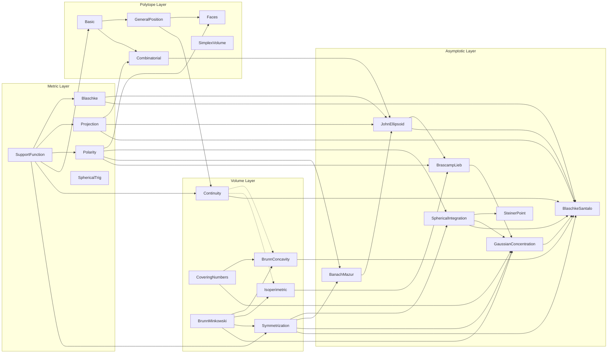

# Module Guide

Directory layout, internal dependencies, and main declarations in `lean-convex-geometry`.

## Repository Layout

```text
.
├── Challenge.lean                          # Mathlib-only Comparator statement surface (30 landmark theorems)
├── Solution.lean                           # Comparator proofs bridging Challenge.lean to ConvexGeom
├── comparator.json                         # lake comparator configuration (standard axioms only)
├── formalization.yaml                      # mathlib-initiative v0.4 metadata, provenance & alignment
├── ConvexGeom.lean                         # Root module re-exporting all 4 layers
├── ConvexGeom/
│   ├── Metric.lean                         # Layer barrel for ConvexGeom.Metric.*
│   ├── Metric/
│   │   ├── SupportFunction.lean            # Support calculus, mapLinear, Hörmander isometry, bodyOfSupportFn
│   │   ├── Blaschke.lean                   # Completeness of ConvexBody and Blaschke Selection Theorem
│   │   ├── Projection.lean                 # Metric projection, normal cones, supporting hyperplanes
│   │   ├── Polarity.lean                   # Polar bodies, Bipolar Theorem, gauge–support duality
│   │   └── SphericalTrig.lean              # Spherical laws of cosines/sines, dihedral angles, spherical caps
│   ├── Polytope.lean                       # Layer barrel for ConvexGeom.Polytope.*
│   ├── Polytope/
│   │   ├── Basic.lean                      # Finite convex hulls, inscribed approximation, vertex push-out
│   │   ├── SimplexVolume.lean              # d-simplex volume |det|/d! (linear map & matrix det)
│   │   ├── GeneralPosition.lean            # Affine & spherical general position density
│   │   ├── Combinatorial.lean              # Radon, Helly, Minkowski–Carathéodory, Straszewicz, Jung
│   │   └── Faces.lean                      # Weyl–Minkowski V→H duality, simplicial facets, facet-cone tiling
│   ├── Volume.lean                         # Layer barrel for ConvexGeom.Volume.*
│   ├── Volume/
│   │   ├── Continuity.lean                 # Volume scaling, half-ball bounds, continuity, maximizers, symmDiffVol
│   │   ├── CoveringNumbers.lean            # Metric & translative covering/packing volumetric bounds
│   │   ├── BrunnMinkowski.lean             # Prékopa–Leindler, Brunn–Minkowski, isodiametric inequality
│   │   ├── BrunnConcavity.lean             # Brunn concavity, convolutions, Rogers–Shephard, central intersection
│   │   ├── Isoperimetric.lean              # Minkowski's first inequality and Euclidean isoperimetry
│   │   └── Symmetrization.lean             # Reflection, Minkowski, central, and Steiner symmetrization
│   ├── Asymptotic.lean                     # Layer barrel for ConvexGeom.Asymptotic.*
│   ├── Asymptotic/
│   │   ├── SphericalIntegration.lean       # sphereProb, polar volume, mean width, Dual Urysohn
│   │   ├── BanachMazur.lean                # Symmetric bodies, ellipsoids, Mahler/Santaló volume, BM distances
│   │   ├── SteinerPoint.lean               # Spherical isotropic identity and Steiner point
│   │   ├── JohnEllipsoid.lean              # Fritz John's theorem, Dvoretzky–Rogers, Banach–Mazur compactum
│   │   ├── BrascampLieb.lean               # Loomis–Whitney, Brascamp–Lieb, Barthe, Ball's reverse isoperimetry
│   │   ├── GaussianConcentration.lean      # Gaussian width, Gaussian/spherical concentration, JL, Dvoretzky
│   │   └── BlaschkeSantalo.lean            # Directional Steiner symmetrization, Santaló point, Blaschke–Santaló, Urysohn
│   └── Verification/                       # Axiom audit tool, headline snapshot, internal checks
├── docs/
│   ├── MODULES.md                          # This file
│   ├── CONVENTIONS.md                      # Conventions, proof routes, divergences, and verification tiers
│   └── ROADMAP.md                          # Planned targets and contribution guide
├── scripts/                                # Tiered verification, Comparator, source hygiene & metadata validators
├── LICENSE                                 # Apache License 2.0
├── CITATION.cff                            # Citation metadata
└── README.md                               # Project overview
```

## Module Dependency Graph

Solid arrows denote `public import` dependencies; dashed arrows denote private proof-only imports.



All four layer barrels and their leaf modules are re-exported by [`ConvexGeom.lean`](../ConvexGeom.lean).

---

## Metric Layer (`ConvexGeom.Metric`)

### [`ConvexGeom/Metric/SupportFunction.lean`](../ConvexGeom/Metric/SupportFunction.lean)
Support functions, linear transport, Hausdorff metric, and Minkowski's representation theorem.

- **Constructors & transport:** `bodySingleton`, `bodyClosedBall`, `mapLinear`, `dist_mapLinear_le`, `supportFn`, `supportFn_minkowski_add`, `supportFn_body_smul`, `supportFn_mapLinearIsometry`, `supportFn_convexOn`
- **Separation & width:** `supportFn_le_iff_subset`, `supportFn_injective`, `mem_iff_forall_inner_le_supportFn`, `width`, `diam_eq_sSup_width`, `diam_eq_sSup_width_sphere`
- **Hörmander's embedding:** `supportFnOnBall`, `dist_le_iff_supportFn_sub_le`, `dist_le_iff_supportFn_sub_le_sphere`, `isometry_supportFnOnBall`, `dist_add_right`, `dist_add_le`, `dist_smul`
- **Minkowski's representation:** `bodyOfSupportFn`, `supportFn_bodyOfSupportFn`, `exists_convexBody_supportFn_eq`

### [`ConvexGeom/Metric/Blaschke.lean`](../ConvexGeom/Metric/Blaschke.lean)
Completeness and compactness of `ConvexBody E` via Hörmander's isometry and Arzelà–Ascoli.

- **Completeness:** `isClosed_range_supportFnOnBall`, `instCompleteSpaceConvexBody`
- **Blaschke Selection Theorem:** `isCompact_subset_closedBall`, `isCompact_subset_of_isCompact`, `blaschke_selection`

### [`ConvexGeom/Metric/Projection.lean`](../ConvexGeom/Metric/Projection.lean)
Nearest-point metric projection, outer normal cones, and the Supporting Hyperplane Theorem.

- **Metric projection:** `metricProj`, `metricProj_eq_iff`, `sq_norm_metricProj_sub_le`, `lipschitzWith_metricProj`, `metricProj_mem_frontier_of_not_mem`
- **Normal cones & supporting hyperplanes:** `normalCone`, `strictNormalCone`, `mem_normalCone_iff_supportFn`, `exists_supporting_normal_of_mem_frontier`, `exists_unit_supportFn_eq_of_mem_frontier`

### [`ConvexGeom/Metric/Polarity.lean`](../ConvexGeom/Metric/Polarity.lean)
One-sided polarity $S^\circ = \{y \mid \forall x \in S,\; \langle x, y \rangle \le 1\}$, bipolarity, and gauge–support duality.

- **Polar calculus:** `polarBody`, `bodyPolar`, `polarBody_closedBall`, `polarBody_image_continuousLinearMap`
- **Bipolar Theorem:** `polarBody_polarBody`
- **Gauge–support duality:** `gauge_polarBody_eq_supportFn`, `supportFn_bodyPolar_eq_gauge`

### [`ConvexGeom/Metric/SphericalTrig.lean`](../ConvexGeom/Metric/SphericalTrig.lean)
Dimension-independent spherical trigonometry, dihedral angles, and spherical caps in any real inner product space.

- **Spherical angles & laws:** `sphericalTangent`, `sphericalAngle`, `spherical_law_of_cosines`, `spherical_triangle_inequality`, `gramDet3`, `gramDet3_eq_sq_sin_mul`, `spherical_law_of_sines`
- **Dihedral angles & caps:** `dihedralAngle`, `sphericalCap`, `sphericalCap_eq_closedBall_inter_sphere`, `sphericalCap_cos_eq_angle_le`, `image_sphericalCap_linearIsometry`, `sphericalCap_zero_union_neg`

---

## Polytope Layer (`ConvexGeom.Polytope`)

### [`ConvexGeom/Polytope/Basic.lean`](../ConvexGeom/Polytope/Basic.lean)
Finite convex hulls as `ConvexBody E`, Hausdorff approximation, and radial vertex push-out to $S^{d-1}$.

- **Polytopes & approximation:** `bodyConvexHull`, `supportFn_bodyConvexHull`, `hausdorffDist_convexHull_range_le`, `exists_polytope_dist_lt`
- **Vertex push-out:** `exists_ray_mem_sphere`, `exists_pushOut_vertex_sphere`, `exists_pushOut_range_sphere`

### [`ConvexGeom/Polytope/SimplexVolume.lean`](../ConvexGeom/Polytope/SimplexVolume.lean)
Lebesgue volume of a $d$-simplex via permutation tiling of $[0, 1]^d$ and a unit-determinant shear.

- **Standard simplices:** `volume_orderSimplex`, `volume_solidSimplex`
- **Edge map & matrix:** `simplexEdgeMap`, `simplexEdgeMatrix`, `det_simplexEdgeMap_eq_det_matrix`
- **General $d$-simplices:** `volume_convexHull_simplex`, `volume_convexHull_simplex_matrix`, `volume_convexHull_simplex_euclideanSpace`, `volume_convexHull_simplex_euclideanSpace_matrix`

### [`ConvexGeom/Polytope/GeneralPosition.lean`](../ConvexGeom/Polytope/GeneralPosition.lean)
Affine and spherical general position density and inscribed general-position approximation.

- **Affine general position:** `InGeneralPosition`, `InGeneralPosition.injective`, `InGeneralPosition.affineEquiv`, `exists_generalPosition_dist_lt`, `exists_generalPosition_dist_lt_of_fintype`
- **Spherical general position:** `InSphericalGeneralPosition`, `not_ball_inter_sphere_subset_affineSubspace`, `exists_sphericalGeneralPosition_snoc`, `exists_sphericalGeneralPosition_dist_lt`, `exists_sphericalGeneralPosition_dist_lt_of_fintype`
- **Approximation:** `nonempty_interior_convexHull_of_inGeneralPosition`, `exists_generalPosition_polytope_dist_lt`, `exists_inscribed_generalPosition_polytope_dist_lt`

### [`ConvexGeom/Polytope/Combinatorial.lean`](../ConvexGeom/Polytope/Combinatorial.lean)
Finite-dimensional combinatorial and extremal convex geometry.

- **Radon & Helly:** `radon_partition_card_ge`, `radon_partition_fin`, `helly_convexBody`, `helly_convexBody_finset`
- **Minkowski–Carathéodory & Straszewicz:** `isCompact_convexHull_of_isCompact`, `convexHull_extremePoints_eq`, `mem_exposedPoints_of_isMaxOn_norm_sub`, `extremePoints_subset_closure_exposedPoints`, `closure_convexHull_exposedPoints`
- **Jung's theorem:** `jung_circumradius_finset`, `jung_circumradius`, `jung_circumradius_convexBody`

### [`ConvexGeom/Polytope/Faces.lean`](../ConvexGeom/Polytope/Faces.lean)
Weyl–Minkowski $V \to H$ duality via polarity, facet simpliciality, and radial facet-cone tiling.

- **Weyl–Minkowski duality:** `tightVertices`, `finite_extremePoints_polarBody`, `facetNormals`, `polarBody_eq_convexHull_facetNormals`, `weyl_minkowski_halfspaces`, `facetNormals_irredundant`
- **Facets & simpliciality:** `polytopeFacet`, `polytopeFacet_eq_convexHull_tightVertices`, `affineSpan_polytopeFacet`, `card_tightVertices_eq_finrank_of_inGeneralPosition`
- **Facet-cone tiling:** `facetCone`, `iUnion_facetCone_eq`, `pairwise_aedisjoint_facetCone`, `addHaar_convexHull_eq_sum_facetCone`

---

## Volume Layer (`ConvexGeom.Volume`)

### [`ConvexGeom/Volume/Continuity.lean`](../ConvexGeom/Volume/Continuity.lean)
Volume-root scaling, half-ball bounds, Hausdorff continuity of volume, polytope supremum reductions, and symmetric-difference volume.

- **Scaling & half-balls:** `addHaar_smul_rpow_inv_finrank`, `addHaar_halfBall`, `addHaar_le_half_ball`, `addHaar_le_half_closedBall_of_zero_not_mem_interior`, `zero_mem_interior_of_addHaar_gt_half_closedBall`
- **Continuity & maximizers:** `continuous_addHaar_convexBody`, `continuous_addHaarReal_convexBody`, `continuous_addHaar_convexHull_range`, `exists_max_addHaar_convexHull_of_isCompact`, `strict_addHaar_convexHull_insert_of_notMem`, `iSup_addHaar_convexHull_closedBall_eq_sphere`, `mem_sphere_of_max_addHaar_convexHull_closedBall`, `iSup_addHaar_convexHull_sphere_eq_generalPosition`
- **Symmetric-difference metric:** `symmDiffVol`, `symmDiffVolReal`, `symmDiffVol_triangle`, `abs_measureReal_sub_le_symmDiffVolReal`, `symmDiffVol_vadd`, `symmDiffVol_smul`, `tendsto_symmDiffVol_self`, `continuous_symmDiffVolReal_convexBody`, `continuous_symmDiffVol_convexBody`

### [`ConvexGeom/Volume/CoveringNumbers.lean`](../ConvexGeom/Volume/CoveringNumbers.lean)
Metric and translative covering/packing volumetric bounds in finite-dimensional normed spaces.

- **Metric covering & packing:** `measure_le_externalCoveringNumber_mul_closedBall`, `packingNumber_mul_ball_le_measure_add_ball`, `inv_pow_le_externalCoveringNumber_closedBall`, `packingNumber_closedBall_le`, `coveringNumber_closedBall_le_three_div`
- **Translative covering:** `IsTranslativeCover`, `translativeCoveringNumber`, `translativeCoveringNumber_mul_le`, `measure_le_translativeCoveringNumber_mul`, `translativeCoveringNumber_sub_mul_le`, `translativeCoveringNumber_symm_smul_le`

### [`ConvexGeom/Volume/BrunnMinkowski.lean`](../ConvexGeom/Volume/BrunnMinkowski.lean)
Prékopa–Leindler (layer-cake + Tonelli induction), Brunn–Minkowski, and corollaries.

- **Prékopa–Leindler:** `brunn_minkowski_one_dim`, `prekopa_leindler_one_dim`, `prekopa_leindler_pi`, `prekopa_leindler`
- **Brunn–Minkowski:** `brunn_minkowski_mul`, `brunn_minkowski_mul_compact`, `brunn_minkowski_compact`, `brunn_minkowski_convexBody`
- **Corollaries:** `isodiametric_inequality`, `logConcave_marginal_prod`

### [`ConvexGeom/Volume/BrunnConcavity.lean`](../ConvexGeom/Volume/BrunnConcavity.lean)
Hyperplane sections, log-concave convolutions, covariograms, Rogers–Shephard, and asymmetric covering bounds.

- **Sections & convolutions:** `slice`, `logConcave_sections`, `brunn_concavity_sections`, `concaveOn_volume_slice_rpow`, `logConcave_convolution`
- **Covariogram & Rogers–Shephard:** `covariogram`, `covariogram_lintegral`, `covariogram_rpow_concave`, `two_pow_mul_volume_le_volume_diff`, `rogers_shephard`
- **Central intersection & asymmetric covering:** `reflectedCovariogram`, `reflectedCovariogram_lintegral`, `exists_reflectedCovariogram_ge`, `translativeCoveringNumber_mul_volume_le_four_pow`, `translativeCoveringNumber_convex_smul_le`

### [`ConvexGeom/Volume/Isoperimetric.lean`](../ConvexGeom/Volume/Isoperimetric.lean)
First variation of volume, Minkowski's first inequality, and Euclidean isoperimetry (lower outer Minkowski content).

- **First inequality:** `volume_add_smul_ge`, `minkowski_first_diff_ge`, `minkowskiSurfaceArea`, `minkowski_first_inequality`
- **Isoperimetry:** `minkowskiSurfaceArea_closedBall`, `isoperimetric_inequality`, `isoperimetric_inequality_ball`

### [`ConvexGeom/Volume/Symmetrization.lean`](../ConvexGeom/Volume/Symmetrization.lean)
Hyperplane reflection, Minkowski and central symmetrization, and Steiner symmetrization on `ℝ × E`.

- **Reflection & Minkowski / central:** `reflectHyperplane`, `reflectBody`, `minkowskiSymm`, `supportFn_minkowskiSymm`, `reflectBody_minkowskiSymm`, `volume_le_volume_minkowskiSymm`, `diam_minkowskiSymm_le`, `centralSymm`, `volume_le_volume_centralSymm`
- **Steiner:** `steinerSymm`, `convex_steinerSymm`, `isCompact_steinerSymm`, `volume_steinerSymm`, `steinerSymm_dist_le_diam`, `bodySteinerSymm`, `volume_bodySteinerSymm`

---

## Asymptotic Layer (`ConvexGeom.Asymptotic`)

### [`ConvexGeom/Asymptotic/SphericalIntegration.lean`](../ConvexGeom/Asymptotic/SphericalIntegration.lean)
Spherical cone probability measure, polar-coordinate volume formula, mean width, and Urysohn bounds.

- **Spherical measure:** `sphereMap`, `sphereProb`, `sphereProb_eq_of_isAddHaarMeasure`, `measurePreserving_sphereMap_sphereProb`, `measurePreserving_sphereNeg_sphereProb`
- **Polar volume:** `addHaar_eq_lintegral_gauge_inv_pow`, `addHaar_real_eq_integral_gauge_inv_pow`, `addHaar_real_polarBody_eq_integral_supportFn_inv_pow`
- **Mean width:** `meanWidth`, `integral_width_eq_two_mul_meanWidth`, `meanWidth_add`, `meanWidth_smul`, `meanWidth_translate`, `meanWidth_bodyClosedBall`, `lipschitzWith_meanWidth`, `meanWidth_linearIsometry`, `meanWidth_mapLinearIsometry`, `meanWidth_minkowskiSymm`, `meanWidth_centralSymm`
- **Urysohn:** `dual_urysohn_inequality`, `urysohn_of_santalo`, `urysohn_of_santalo_at`

### [`ConvexGeom/Asymptotic/BanachMazur.lean`](../ConvexGeom/Asymptotic/BanachMazur.lean)
Origin-symmetric bodies, ellipsoids, Mahler volume, and Banach–Mazur distances.

- **Symmetry & ellipsoids:** `IsOriginSymmetric`, `det_adjoint_eq_det`, `polarBody_linearEquiv_image`, `ellipsoid`, `polarBody_ellipsoid`, `addHaar_ellipsoid`
- **Mahler volume:** `mahlerVolume`, `mahlerVolume_linearEquiv`, `mahlerVolume_ellipsoid`, `mahlerVolumeAt`, `mahlerVolumeAt_affineEquiv`, `santaloMahlerVolume`, `santaloMahlerVolume_translate`, `santaloMahlerVolume_affineEquiv`
- **Banach–Mazur distances:** `banachMazurDist`, `banachMazurEDist`, `banachMazurEDist_mul_triangle`, `banachMazurDist_polar`, `affineBanachMazurDist`, `affineBanachMazurEDist`, `affineBanachMazurDist_affineEquiv_left`, `affineBanachMazurDist_affineEquiv_right`, `affineBanachMazurEDist_mul_triangle`

### [`ConvexGeom/Asymptotic/SteinerPoint.lean`](../ConvexGeom/Asymptotic/SteinerPoint.lean)
Spherical second-moment isotropy and the Steiner point of a convex body.

- **Spherical isotropy:** `integral_sphereProb_id`, `integral_inner_sq_sphereProb`, `integral_inner_mul_inner_sphereProb`, `finrank_smul_integral_inner_smul_sphereProb`
- **Steiner point:** `steinerPoint`, `steinerPoint_bodySingleton`, `steinerPoint_add`, `steinerPoint_smul`, `steinerPoint_translate`, `steinerPoint_neg_one_smul`, `steinerPoint_mapLinearIsometry`, `steinerPoint_bodyClosedBall`, `steinerPoint_mem`, `dist_steinerPoint_le`, `lipschitzWith_steinerPoint`, `continuous_steinerPoint`

### [`ConvexGeom/Asymptotic/JohnEllipsoid.lean`](../ConvexGeom/Asymptotic/JohnEllipsoid.lean)
Maximal-volume inscribed ellipsoids, John's decomposition of the identity, Dvoretzky–Rogers, Fritz John's / Löwner's theorems, and the Banach–Mazur compactum.

- **Rank-one operators & John decompositions:** `rankOne`, `IsJohnDecomposition`, `IsJohnDecomposition.sum_weights`, `IsJohnDecomposition.det_sum_rankOne_ge_prod`
- **John's position & decomposition:** `IsJohnPosition`, `exists_affineEquiv_isJohnPosition`, `exists_linearEquiv_isJohnPosition_of_isOriginSymmetric`, `john_decomposition_of_john_position`, `subset_finrank_smul_of_john_position`, `subset_sqrt_finrank_smul_of_john_position`, `dvoretzky_rogers_lemma`
- **Fritz John, Löwner & Banach–Mazur compactum:** `john_theorem`, `john_theorem_symmetric`, `loewner_theorem_symmetric`, `banachMazurDist_closedBall_le_sqrt_finrank`, `banachMazurDist_le_finrank`, `affineBanachMazurDist_closedBall_le_finrank`, `affineBanachMazurDist_le_finrank_sq`, `banachMazurDist_attained`, `affineBanachMazurDist_attained`, `exists_subseq_banachMazurDist_tendsto_one`, `exists_subseq_affineBanachMazurDist_tendsto_one`

### [`ConvexGeom/Asymptotic/BrascampLieb.lean`](../ConvexGeom/Asymptotic/BrascampLieb.lean)
Loomis–Whitney, Barthe's optimal-transport proofs of the geometric rank-one Brascamp–Lieb and reverse Brascamp–Lieb inequalities, and Ball's volume-ratio / reverse isoperimetric inequalities.

- **Loomis–Whitney:** `loomis_whitney_lintegral`, `loomis_whitney_pi`, `loomis_whitney`
- **Monotone transport & Brascamp–Lieb:** `stdGaussianDensity`, `exists_gaussian_transport`, `brascamp_lieb_rankOne`, `reverse_brascamp_lieb_rankOne`
- **Volume ratio & reverse isoperimetry:** `volume_le_two_pow_of_john_position_symmetric`, `ball_volume_ratio_symmetric`, `volume_le_simplex_bound_of_john_position`, `ball_volume_ratio`, `minkowskiSurfaceArea_le_finrank_mul_volume_of_closedBall_subset`, `ball_reverse_isoperimetric_symmetric`, `ball_reverse_isoperimetric`, `barthe_polar_volume_of_john_position_symmetric`, `barthe_outer_volume_ratio_symmetric`, `john_position_gaussian_measure_le`

### [`ConvexGeom/Asymptotic/GaussianConcentration.lean`](../ConvexGeom/Asymptotic/GaussianConcentration.lean)
Standard Gaussian measure on finite-dimensional inner product spaces, Gaussian width, Gaussian and spherical concentration of measure, Johnson–Lindenstrauss, and Dvoretzky's theorem.

- **Standard Gaussian & moments:** `stdGaussian`, `measurePreserving_linearIsometryEquiv_stdGaussian`, `measurePreserving_orthonormalBasis_stdGaussian`, `measurePreserving_inner_stdGaussian`, `measurePreserving_linearComb_stdGaussian`, `measurePreserving_homeomorphUnitSphereProd_stdGaussian`, `integral_norm_sq_stdGaussian`, `integral_norm_pow_four_stdGaussian`, `div_sqrt_le_integral_norm_stdGaussian`
- **Gaussian width:** `gaussianWidth`, `gaussianWidth_eq_integral_norm_mul_meanWidth`
- **Gaussian & spherical concentration:** `gaussian_enlargement_two_sets`, `gaussian_enlargement_thickening`, `gaussian_lipschitz_mgf_le`, `gaussian_lipschitz_upper_tail`, `gaussian_lipschitz_concentration_mean`, `gaussian_lipschitz_concentration_median`, `spherical_enlargement_two_sets`, `spherical_enlargement_thickening`, `spherical_lipschitz_concentration_median`
- **Johnson–Lindenstrauss & Dvoretzky:** `chi_sq_upper_tail`, `chi_sq_lower_tail`, `johnson_lindenstrauss`, `john_position_gaussian_gauge_lower_bound`, `milman_gaussian_dvoretzky`, `dvoretzky_theorem`

### [`ConvexGeom/Asymptotic/BlaschkeSantalo.lean`](../ConvexGeom/Asymptotic/BlaschkeSantalo.lean)
Arbitrary-direction Steiner symmetrization, second-moment strict decrease, existence of the Santaló point, Meyer–Pajor's symmetrization inequality, the Blaschke–Santaló inequality, and Urysohn's inequality.

- **Directional Steiner symmetrization & second moment:** `orthoHyperplane`, `orthoSplitProd`, `steinerSymmDir`, `bodySteinerSymmDir`, `reflectBody_bodySteinerSymmDir`, `volume_bodySteinerSymmDir`, `secondMoment`, `continuous_secondMoment`, `secondMoment_bodySteinerSymmDir_lt`
- **Santaló point & Meyer–Pajor:** `polarVolAt`, `convexOn_polarVolAt`, `exists_santaloPoint`, `mahlerVolume_eq_santaloMahlerVolume_of_isOriginSymmetric`, `upperSemicontinuousOn_santaloMahlerVolume`, `santaloMahlerVolume_le_bodySteinerSymmDir`
- **Blaschke–Santaló & Urysohn:** `blaschke_santalo`, `blaschke_santalo_symmetric`, `blaschke_santalo_real`, `blaschke_santalo_symmetric_real`, `urysohn_inequality`

---

## Verification

Verification tooling lives under [`ConvexGeom/Verification/`](../ConvexGeom/Verification/) and is invoked via [`scripts/verify.sh`](../scripts/verify.sh); see [`CONVENTIONS.md`](CONVENTIONS.md) for details.
